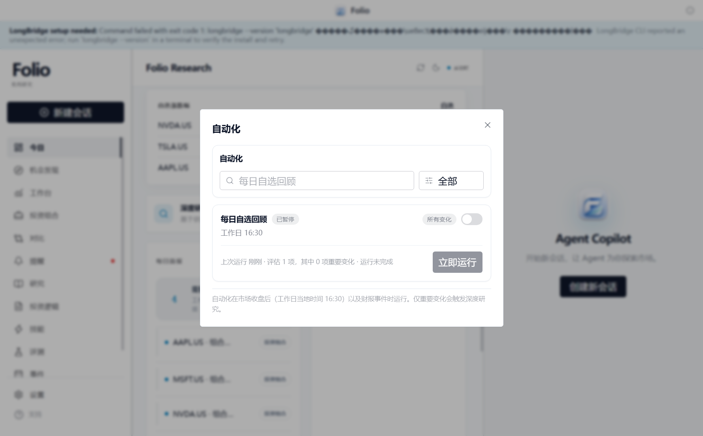

# #185：明确 stale 行情的评估语义

Refs #185。本次只修复 Provider 明确返回 `provenance.stale === true` 的行情，不宣称完成或关闭整个 issue。

## 原因与改动

`market.quote` 已合并 Provider provenance，但 automation runner 原先只保留 `result.data`，因此新近请求得到的旧行情仍可能被判为“无实质变化”，甚至凭旧涨跌幅触发研究。

- 保留 capability result provenance，明确 stale 时记录 `SYMBOL: quote stale`，使整轮结果为 `incomplete`。
- stale 价格不参与涨跌幅判断，也不发送 `notify=all` 的“无变化”通知。
- 独立研究 diff / 日历信号仍可触发研究及重要变化通知；其他健康标的照常评估。整轮仍保持 incomplete。
- 下一轮恢复 fresh 后可正常完成；不修改历史记录、持久化 schema 或 UI 组件。

未覆盖：根据 `Quote.timestamp` 推断过期、交易时段/休市阈值、持仓 `sourceFetchedAt` 年龄策略。`delayed` 不等同于 `stale`。这些语义继续留在 #185。

## 可复现测试报告

环境：Windows NT 10.0.26100 / Bun 1.4.2 / Node 22.16.0。基线：`upstream/main` `9afa4604e71a008391622b13a5415c87a9721e90`。执行日期：2026-10-24。

```text
bun test packages/shared/src/automation/runner-freshness.test.ts
修复前：1 pass / 7 fail，复现 stale 被误判为 no_material_update / material_update。

bun test packages/shared/src/automation --isolate
修复后：82 pass / 0 fail，6 files，224 expect() calls。

bun test --isolate
2067 pass / 10 skip / 0 fail，217 files，8916 expect() calls。

bun run typecheck
core / i18n / shared / ui / electron 全部 exit 0。

bun run --cwd apps/electron build
exit 0；Vite 仍提示部分 chunk 体积较大，不是构建失败。

git -c core.whitespace=cr-at-eol diff --check
exit 0；runner 的基线文件本来就是 CRLF，保留原换行格式。
```

全量跳过项：2 项未探测到 Bash 的 shell pipefail 测试、7 项缺少未提交的真实账户 fixture 的 Longbridge CLI / phase-2 测试、1 项当前 Windows 无符号链接创建权限的测试。没有把这些跳过项记为通过，也未在本次改动中新增 skip。

8 个新增测试覆盖两种通知模式、stale-only 大幅波动、独立研究变化、delayed/旧 timestamp 与 stale 的区分、混合健康标的、恢复，以及真实文件仓库重载后的 brief quiet 排除。

## Electron 持久化与界面验收

仓库根目录执行：

```powershell
# 若当前安装未下载 Electron，指定本机已有的 Electron 可执行文件；正常安装可省略此项。
$env:ELECTRON_BINARY='D:\GitHub\folio\apps\electron\node_modules\electron\dist\electron.exe'
bun apps/electron/e2e/automation-freshness.ts
```

实际输出：

```text
PASS stale-incomplete: persisted runner outcome displayed through real IPC after app startup
PASS fresh-recovered: persisted runner outcome displayed through real IPC after app startup
```

脚本使用真实 `createMarketQuoteCapability` / provenance 合并、`runAutomation`、文件仓库和 `buildBrief`，先在 Bun 进程执行并落库，再分别启动已构建的 Electron，经过真实 main/preload/IPC/UI 读取结果。第二次启动保留第一轮历史，验证恢复后的最新状态。没有替换 IPC handler，也不是直接向 UI 注入 outcome。

**验收边界**：外部行情由 fixture 提供；不是生产调度器执行，也未验证真实 Longbridge/Massive/模型服务。研究入口在本场景不应调用，通知使用计数回调，不发送系统/外部通知。隔离 profile 中的规则故意禁用，防止应用调度器运行；截图中的“已暂停”是测试设置，不是 stale 自动禁用规则。背景为应用 demo 数据，顶部 Longbridge 环境提示来自本机未安装 CLI。

| 场景 | outcome | 通知数 | brief quiet 数 |
| --- | --- | --- | --- |
| Provider stale，平价 | incomplete | 0 | 0 |
| 下一轮 fresh，平价 | no_material_update | 1 | 1 |

原始运行产物：[stale-incomplete.json](stale-incomplete.json)、[fresh-recovered.json](fresh-recovered.json)。脚本重新执行会把新截图/JSON 写到 `apps/electron/e2e/artifacts/automation-freshness/`，不覆盖此处归档证据。

### 修改后：过期行情



### 修改后：行情恢复


## 审阅与限制

独立静态代码审阅未发现本增量的 P1/P2 阻塞问题。日历信号及研究/通知抛错路径有既有测试，但新增测试未单独穷举它们与 stale 的所有组合。

GitHub 查询时 `PR checks` 与 `Eval Smoke` 均为 `disabled_manually`，以上是本地验证结果，不将无远端检查视为 CI 通过。
